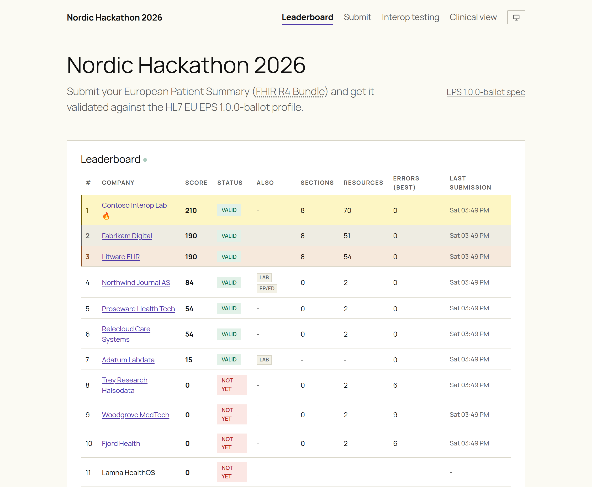
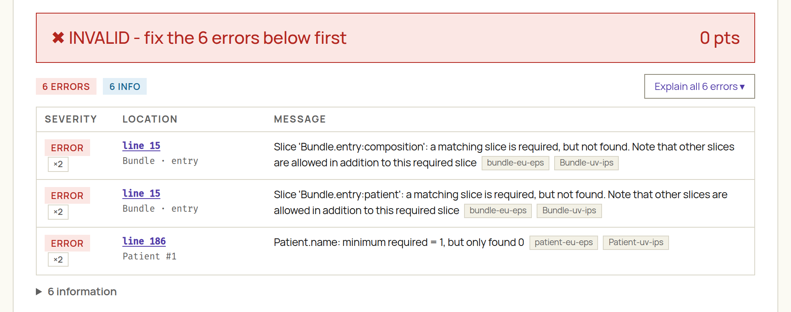
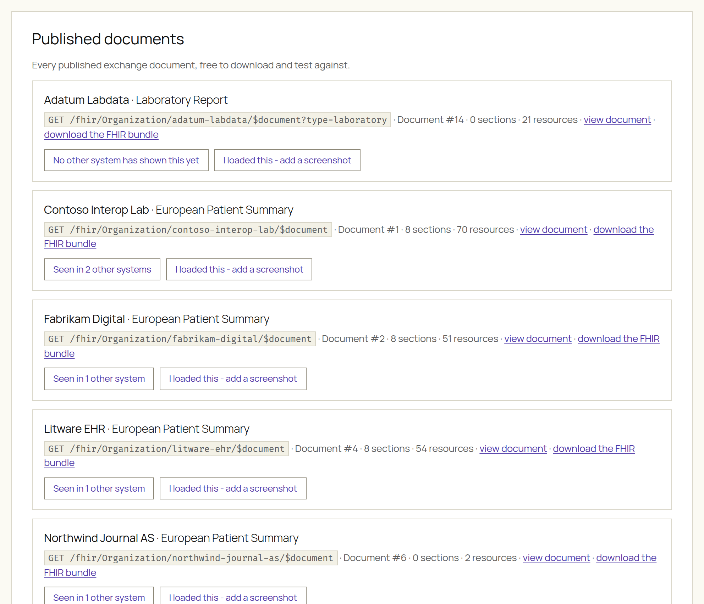
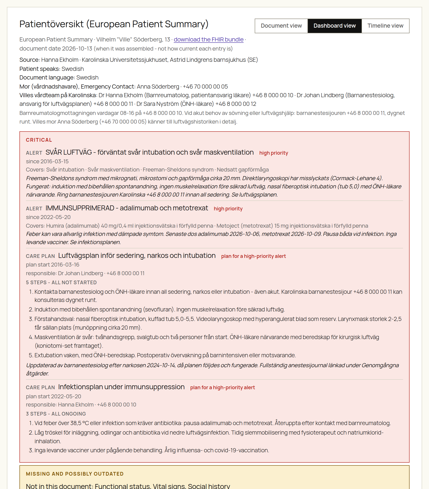
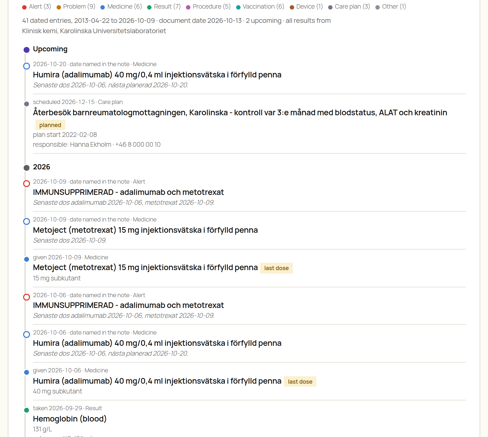

# Provbana - FHIR document validation, scoring and interop for hackathons and connectathons

Provbana (Swedish for "test track") is everything behind a FHIR document track at a
hackathon or connectathon: a validator, a scoring service with a live leaderboard, an
interop board where teams fetch each other's documents and report back, a clinical view
that renders any submitted document, and synthetic worked examples.

What a given event scores is configuration, not code. One folder under `events/` names
the event, picks the document types and the guide versions each is validated against,
sets the points and holds the worked examples - see
[Running it for your event](#running-it-for-your-event).

It was built for, and first used at, the European Patient Summary track of the
[Nordic Hackathon 2026](https://nordichackathon2026.blogs.dsv.su.se), which ships here as
the complete example in `events/nordic-hackathon-2026/`. There the patient summary is
the track and what the leaderboard ranks; the four other EHDS Article 14 categories HL7
Europe publishes a guide for - laboratory report, prescription and dispense, imaging
report, discharge report - are accepted as well and validated against their own guide,
for a flat bonus rather than the summary's points. A submission says nothing about which
it is; the service reads that off the bundle. See
[Document types](provbana/README.md#document-types).

## What it looks like

The live leaderboard, with a chip for each other document type a company has passed:



Submitting a bundle gets a verdict in seconds: what Matchbox found, grouped and linked
to the line it lands on, with the bundle itself embedded below and marked up:



Each company's best document of each type is published for the others to fetch, load
into their own system and report back on with a screenshot:



The clinical view renders any submitted document the way a clinician would want to read
it. The dashboard puts critical alerts and their care plans first and calls out what is
missing or possibly outdated; the timeline lays every dated entry out in order, upcoming
ones on top:





The companies shown are demo data from `provbana/seed_demo.py`, and the patient is
the synthetic Ville scenario.

| Directory | What it is |
|---|---|
| `provbana/` | The service: FastAPI + SQLite in a single `app.py`, its tests, Dockerfile and [README](provbana/README.md) with run instructions, scoring rules and the API. |
| `provbana/event.py` | Reads and checks the event folder. A typo in `event.toml` stops the service at startup with the key named. |
| `provbana/backup.py` | Snapshots the results (database, submitted bundles, screenshots) every 15 minutes and restores them. Restore is CLI-only and owner-checked - see [Backups](provbana/README.md#backups). |
| `provbana/reset.py` | Empties the leaderboard daily while the service is open for practice ahead of the event, and stops for good at `PRACTICE_ENDS` - see [Practice resets](provbana/README.md#practice-resets). |
| `provbana/warm.py` | Re-validates one bundle against every category every 20 minutes, so the validator keeps its compiled engines. It drops them after tens of minutes idle, and rebuilding one takes longer than a submission is allowed to - see [Keeping the validator warm](provbana/README.md#keeping-the-validator-warm). |
| `provbana/monitor.py` | Emails the organiser when the service or the page errors, or the validator stops answering, plus a usage digest every morning. It reads a usage log that app.py writes and the daily reset leaves alone - see [Usage and alerts](provbana/README.md#usage-and-alerts). |
| `provbana/examples/` | Seed-only bundles for `seed_demo.py`: the EPS IG's own example (`official-example.json`, `EPSExampleBundle01NoProblemsMedicationAllergies`), two deliberately broken copies of it (`minor-` drops the patient name, `broken-` also drops the Allergies section), a large German synthetic summary (`rich-example.json`) to exercise the caps, and the laboratory and prescription guides' own published examples (`lab-example.json`, `mpd-example.json`) so the leaderboard's "Also" column has something in it. Not served by the app. |
| `events/nordic-hackathon-2026/` | The example event: `event.toml`, the validator's `matchbox.yaml` (HL7 EU EPS and HL7 Sweden base, plus one package per other EHDS document type, and why terminology lookup is left off) and `samples/`, the three scenario bundles (Andrea, cross-border; Arne, complex care; Ville, difficult airway) generated by `generate.py`. Synthetic - no real system, record or person. |
| `itb/` | Docker Compose for [Matchbox](https://github.com/ahdis/matchbox), the FHIR validator the service calls, loading the event's `matchbox.yaml`. |
| `deploy/` | Provisioning and deploying a Hetzner Cloud box running `docker-compose.prod.yml` behind Caddy. |

Quick start, from a clean checkout with Docker running:

```
cd itb && docker compose -p itb up -d matchbox        # validator on :8090, two minutes to load the IGs from cold
cd ../provbana
python3 -m venv .venv && .venv/bin/pip install -r requirements.txt
DATA_DIR=./data MATCHBOX_URL=http://localhost:8090/matchboxv3/fhir .venv/bin/python app.py
```

Then open <http://localhost:8095/>. `provbana/README.md` has the rest. Python 3.11 or
later is needed for `tomllib`.

## Running it for your event

1. Copy `events/nordic-hackathon-2026/` to `events/<your-event>/` and edit `event.toml`:
   - `[event]` - the name, link and dates the page shows, and `canonical_base`, the
     namespace for the identifiers it mints (defaults to `https://$SITE_ADDRESS/fhir`).
   - `[documents]` - which types it accepts (`enabled`, any of `eps`, `laboratory`,
     `mpd`, `imaging`, `hdr`) and which one the leaderboard ranks (`primary`). A
     `[documents.<id>]` table overrides one of them - `igs` to pin another version,
     `extra_igs` to add a national base guide - or defines a type of your own with
     `label`, `long_label`, `short`, `category`, `profile` and `igs`.
   - `[scoring]` - any of the points in [Scoring](provbana/README.md#scoring); what you
     leave out keeps its default.
   - `[[samples]]` - one table per worked example in `samples/<id>.json`. With none,
     the clinical view says so instead of offering a picker.
   - `[identifiers]` - labels for national identifier systems the clinical view does
     not already know (it knows the Swedish, Norwegian, Danish and Finnish ones).
2. Edit `matchbox.yaml` so the validator loads every package in `igs` and `extra_igs`.
   The test suite and `$status` both check that nothing is missing.
3. Optionally add `theme.css` to the folder to override the page's colours; it is
   linked after the built-in styles.
4. Point `EVENT_DIR` at the folder - in `.env` for the compose files, or in the
   environment for `app.py`.

Section scoring and the clinical view read a FHIR document's Composition, so any
document type whose bundle is a `document` works, but scoring is shaped around a
patient summary's sections.

## Deploying

`deploy/provision.sh` creates the box, and `deploy/deploy.sh` copies the checkout to it
and brings up `docker-compose.prod.yml`. `.env.example` lists what goes in `.env`;
`SITE_ADDRESS` is required.

## Archiving an event

When the event is over, `provbana/archive.py` turns a backup snapshot into a static,
read-only copy of the site for GitHub Pages or any static host, so the box can go:

```bash
cd provbana && .venv/bin/python archive.py --data <snapshot> --out <empty dir> --cname <host>
```

It keeps what anyone could read on the live site - the final leaderboard, the interop
board with its screenshots, every submission in the clinical view and the worked
examples - and drops registering, submitting, validating and uploading. The page says
thank you at the top (`archive_note` under `[event]` rewords it). Push the folder to a
repository with Pages enabled and point the hostname at it.
[provbana/README.md](provbana/README.md#archiving) has the details.

Released under the [MIT licence](LICENSE).
